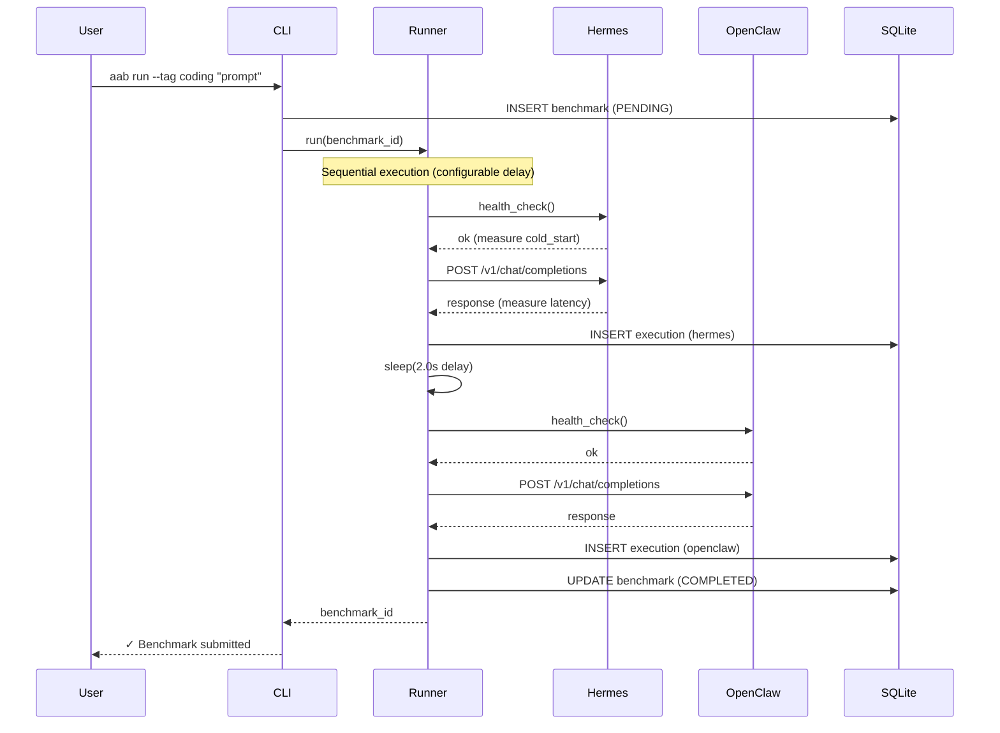
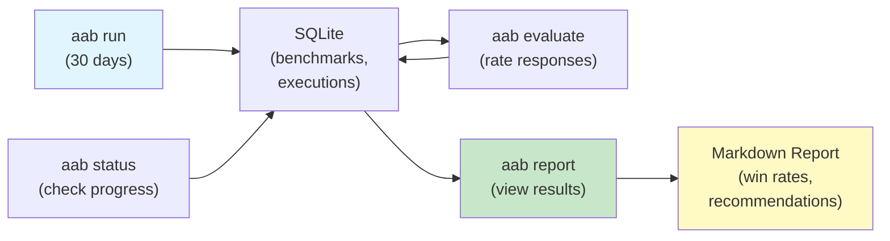

# AgentAssistBench

Benchmark AI agent frameworks against your real workflows. No curated test cases — just your actual tasks, running on both agents, with your judgment deciding the winner.

**[Repository](https://github.com/theprodsde/agent-assist-bench) · [Documentation](docs/) · [Issues](https://github.com/theprodsde/agent-assist-bench/issues)**

---

## The Problem

You're considering an AI agent framework for your work. But how do you know which one is actually better *for your tasks*?

- Synthetic benchmarks (GAIA, WebArena) test curated examples, not your real work
- LLM-as-judge doesn't match your preferences
- You need evidence before committing

## The Solution

AgentAssistBench lets you run your actual tasks against multiple agents side-by-side, then rate the responses yourself. After 30 days, you have data-driven recommendations.

```
Your Real Tasks (daily)
    ↓
  ┌─────────────────┐
  │    Agent 1      │  (e.g., Hermes on Docker)
  └─────────────────┘
    ↓ (store latency, tokens, cost)
┌───────────────────┐
│   SQLite DB       │  Compare per category
├───────────────────┤  (coding, research, writing, devops)
│ Your Ratings      │  Generate win rates
└───────────────────┘  Print recommendations
    ↑
  ┌─────────────────┐
  │    Agent 2      │  (e.g., OpenClaw on Docker)
  └─────────────────┘
```

---

## Quick Start (5 minutes)

### 1. Install

```bash
git clone https://github.com/theprodsde/agent-assist-bench.git
cd agent-assist-bench
pip install -e ".[dev]"
```

### 2. Configure

Create `.env` in project root:

```env
BENCH_HERMES_ENDPOINT=http://localhost:8001/v1
BENCH_OPENCLAW_ENDPOINT=http://localhost:8002/v1
BENCH_HERMES_API_KEY=any-value
BENCH_OPENCLAW_API_KEY=any-value
BENCH_DB_PATH=storage/benchmark.db
```

### 3. Run Agents (Docker)

```bash
docker compose -f docker/docker-compose.yml -f docker/docker-compose.override.yml up -d
```

### 4. Submit Your First Prompt

```bash
aab run --tag coding "Write a binary search in Python"
aab status
```

See [CLI.md](CLI.md) for all commands.

---

## Key Features

✅ **Real agents, real tasks** — Hermes and OpenClaw run as actual frameworks (not LLM proxies)

✅ **Your judgment** — Human-rated evaluations, not LLM-as-judge

✅ **Per-category recommendations** — Tag prompts (`#coding`, `#research`) to get category-specific win rates

✅ **Complete stack comparison** — Measures latency, tokens, cost, and quality together

✅ **Multiple deployments** — Test agents on local Docker, VMs, or managed containers

✅ **Open-source** — MIT license, self-hosted evaluation, no vendor lock-in

---

## How It Works

### Benchmark Flow



### Evaluation & Reporting



---

## Documentation

| Document | Purpose |
|----------|---------|
| [CLI.md](CLI.md) | Command reference (`aab run`, `aab evaluate`, `aab report`, `aab telegram`) |
| [DEPLOYMENT.md](DEPLOYMENT.md) | How to deploy agents locally, on VMs, or in cloud (ACA, Cloud Run) |
| [ARCHITECTURE.md](ARCHITECTURE.md) | System design and component interactions |
| [docs/](docs/) | 16 technical docs: project overview, ADRs, RFCs, roadmap |

---

## Status

**Version: 0.1.0 (MVP)**

| Component | Status |
|-----------|--------|
| CLI (`aab run`, `evaluate`, `report`, `status`) | ✅ |
| Benchmark runner (sequential execution) | ✅ |
| Agent adapters (Hermes, OpenClaw, OpenAI-compatible) | ✅ |
| SQLite storage (CRUD + WAL mode) | ✅ |
| Report generator (per-category win rates) | ✅ |
| Evaluation service (rating + validation) | ✅ |
| Tests (266 unit tests) | ✅ |
| Docker setup (local agents) | ✅ |
| Telegram bot | 🔜 v0.2 |
| REST API | 🔜 v0.2 |
| Terraform (VM + ACA deployment) | 🔜 v0.3 |
| Dashboard UI | 🔜 v1.0 |

See [docs/16-roadmap.md](docs/16-roadmap.md) for the full roadmap.

---

## Development

### Run Tests

```bash
pytest tests/ -v
```

### Lint

```bash
ruff check benchmark/ tests/
ruff format benchmark/ tests/
```

### Type Check

```bash
mypy benchmark/
```

---

## Requirements

- **Python 3.11+**
- **Docker** (optional, for local agent testing)
- **NVIDIA API key** (free tier, if running real agent stack)

---

## License

MIT — See [LICENSE](LICENSE)

---

## Maintainer

**[TheProdSDE](https://github.com/TheProdSDE)**

Open-source project published under [github.com/theprodsde/agent-assist-bench](https://github.com/theprodsde/agent-assist-bench)

---

## Next Steps

1. **Try it locally** — [Quick Start](#quick-start-5-minutes) above
2. **Run 30 days of benchmarks** — Tag your real tasks with categories
3. **Rate responses** — `aab evaluate` after accumulating results
4. **Get recommendations** — `aab report` shows per-category win rates
5. **Deploy at scale** — [DEPLOYMENT.md](DEPLOYMENT.md) for VMs or cloud

---

## Feedback

- Found a bug? [Open an issue](https://github.com/theprodsde/agent-assist-bench/issues)
- Want to contribute? See [CONTRIBUTING.md](CONTRIBUTING.md)
- Questions? Discuss in [Discussions](https://github.com/theprodsde/agent-assist-bench/discussions)

