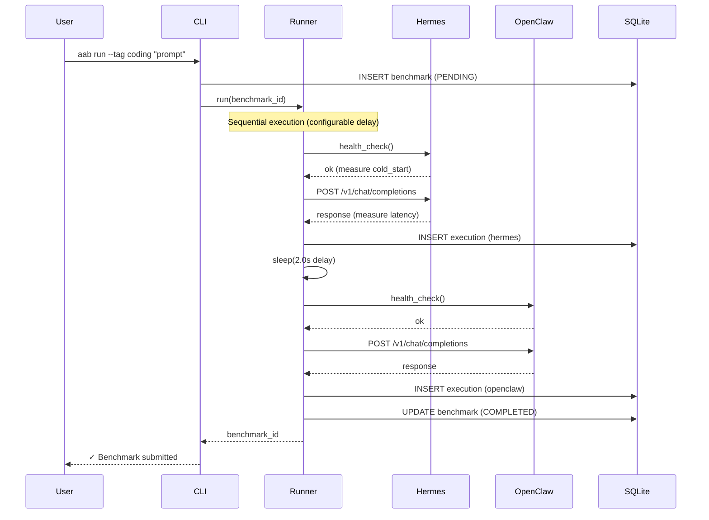
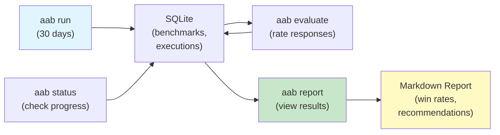

# AgentAssistBench

[](https://github.com/theprodsde/agent-assist-bench/actions/workflows/test.yml)
[](https://github.com/theprodsde/agent-assist-bench/actions/workflows/lint.yml)
[](https://codecov.io/gh/theprodsde/agent-assist-bench)
[](https://www.python.org/downloads/)
[](LICENSE)

Benchmark AI agent frameworks against your real workflows. No curated test cases — just your actual tasks, running on both agents, with your judgment deciding the winner.

**[Repository](https://github.com/theprodsde/agent-assist-bench) · [Documentation](docs/) · [Issues](https://github.com/theprodsde/agent-assist-bench/issues)**

---

## The Problem

You're considering an AI agent framework for your work. But how do you know which one is actually better *for your tasks*?

- Synthetic benchmarks (GAIA, WebArena) test curated examples, not your real work
- LLM-as-judge doesn't match your preferences
- You need evidence before committing

## The Solution

AgentAssistBench lets you run your actual tasks against multiple agents side-by-side, then rate the responses yourself. After 30 days, you have data-driven recommendations.

```
Your Real Tasks (daily)
    ↓
  ┌─────────────────┐
  │    Agent 1      │  (e.g., Hermes on Docker)
  └─────────────────┘
    ↓ (store latency, tokens, cost)
┌───────────────────┐
│   SQLite DB       │  Compare per category
├───────────────────┤  (coding, research, writing, devops)
│ Your Ratings      │  Generate win rates
└───────────────────┘  Print recommendations
    ↑
  ┌─────────────────┐
  │    Agent 2      │  (e.g., OpenClaw on Docker)
  └─────────────────┘
```

---

## Quick Start (5 minutes)

### 1. Install

```bash
git clone https://github.com/theprodsde/agent-assist-bench.git
cd agent-assist-bench
```

**With [uv](https://docs.astral.sh/uv/getting-started/installation/) (recommended):**
```bash
uv sync
```
Then prefix commands with `uv run` — e.g. `uv run aab status`.

**With pip (standard):**
```bash
pip install -e .
```
Then run `aab` directly — e.g. `aab status`.

### 2. Configure

```bash
cp .env.example .env
```

Edit `.env` — at minimum set the agent API keys and endpoints:

```env
BENCH_HERMES_ENDPOINT=http://localhost:8001/v1
BENCH_OPENCLAW_ENDPOINT=http://localhost:8002/v1
BENCH_HERMES_API_KEY=your-hermes-api-key
BENCH_OPENCLAW_API_KEY=your-openclaw-api-key
```

See `.env.example` for all available settings with descriptions.

### 3. Run Agents (Docker)

```bash
docker compose -f docker/docker-compose.yml -f docker/docker-compose.override.yml up -d
```

### 4. Send Prompts — pick your interface

Both options hit the same agents and store results in the same database.

---

#### Option A — CLI (terminal)

```bash
# Submit a prompt — runs against both Hermes and OpenClaw
aab run "Write a binary search in Python"           # pip install
uv run aab run "Write a binary search in Python"    # uv sync

# With category tags for reporting
aab run --tag coding "Write a binary search in Python"
aab run --tag research --tag devops "Explain Kubernetes vs Docker Swarm"

# Check what ran
aab status

# Rate the responses (interactive)
aab evaluate

# Generate a comparison report
aab report
```

See [CLI.md](CLI.md) for all commands.

---

#### Option B — Telegram bot (send from your phone)

```env
# Add to .env
BENCH_TELEGRAM_BOT_TOKEN=your-token-from-botfather
BENCH_TELEGRAM_ALLOWED_CHAT_IDS=your-numeric-chat-id
```

```bash
uv run aab telegram
```

Send any message to your bot — it benchmarks the prompt across both agents and replies with both responses. Prefix `#tag` to categorise:

```
#coding Write a binary search in Python
```

See [Telegram Bot](#telegram-bot) section for full setup.

---

## Key Features

✅ **Real agents, real tasks** — Hermes and OpenClaw run as actual frameworks (not LLM proxies)

✅ **Your judgment** — Human-rated evaluations, not LLM-as-judge

✅ **Per-category recommendations** — Tag prompts (`#coding`, `#research`) to get category-specific win rates

✅ **Complete stack comparison** — Measures latency, tokens, cost, and quality together

✅ **Multiple deployments** — Test agents on local Docker, VMs, or managed containers

✅ **Telegram bot** — Send prompts from your phone, get both responses back instantly

✅ **Open-source** — MIT license, self-hosted evaluation, no vendor lock-in

---

## How It Works

### Benchmark Flow



### Evaluation & Reporting



---

## Telegram Bot

Send prompts from your phone and get both agent responses back in the same chat.

### Setup

**1. Create a bot via [@BotFather](https://t.me/BotFather)**

```
/newbot
```

Follow the prompts. Copy the token it gives you.

**2. Find your Telegram chat ID**

Message [@userinfobot](https://t.me/userinfobot) — it replies with your numeric ID (e.g. `123456789`).

**3. Add to `.env`**

```env
BENCH_TELEGRAM_BOT_TOKEN=123456789:ABCdefGHIjklMNO...
BENCH_TELEGRAM_ALLOWED_CHAT_IDS=123456789
```

`BENCH_TELEGRAM_ALLOWED_CHAT_IDS` restricts the bot to your chat only. Anyone else who messages the bot is silently ignored. Leave it empty only if you intentionally want a public bot.

**4. Start the bot**

```bash
aab telegram        # pip install
uv run aab telegram # uv sync
```

```
Telegram bot polling started — send messages to your bot.
Access restricted to chat IDs: 123456789
Press Ctrl-C to stop.
```

### Usage

Send any message to your bot in Telegram:

```
Write a binary search in Python
```

Prefix `#tag` to categorise the benchmark for reporting:

```
#coding Write a binary search in Python
#research #devops Explain Kubernetes vs Docker Swarm
```

The bot runs the prompt through Hermes and OpenClaw sequentially and replies with both responses side-by-side.

---

## Documentation

| Document | Purpose |
|----------|---------|
| [CLI.md](CLI.md) | Command reference (`aab run`, `aab evaluate`, `aab report`, `aab telegram`) |
| [DEPLOYMENT.md](DEPLOYMENT.md) | How to deploy agents locally, on VMs, or in cloud (ACA, Cloud Run) |
| [ARCHITECTURE.md](ARCHITECTURE.md) | System design and component interactions |
| [docs/](docs/) | 16 technical docs: project overview, ADRs, RFCs, roadmap |

---

## Status

**Version: 0.1.0 (MVP)**

| Component | Status |
|-----------|--------|
| CLI (`aab run`, `evaluate`, `report`, `status`) | ✅ |
| Benchmark runner (sequential execution) | ✅ |
| Agent adapters (Hermes, OpenClaw, OpenAI-compatible) | ✅ |
| SQLite storage (CRUD + WAL mode) | ✅ |
| Report generator (per-category win rates) | ✅ |
| Evaluation service (rating + validation) | ✅ |
| Telegram bot (long-polling, access control) | ✅ |
| Tests (unit, integration, property-based) | ✅ |
| CI (lint, type check, parallel tests) | ✅ |
| Docker setup (local agents) | ✅ |
| REST API | 🔜 v0.2 |
| Terraform (VM + ACA deployment) | 🔜 v0.3 |
| Dashboard UI | 🔜 v1.0 |

See [docs/16-roadmap.md](docs/16-roadmap.md) for the full roadmap.

---

## Development

### Prerequisites

- Python 3.11+
- [uv](https://docs.astral.sh/uv/getting-started/installation/)
- Docker (optional, for local agent testing)

### Setup

```bash
uv sync --group dev
```

### Run Tests

```bash
uv run pytest tests/ -v -n auto
```

### Lint & Format

```bash
uv run ruff check benchmark/ tests/
uv run ruff format benchmark/ tests/
```

### Type Check

```bash
uv run mypy benchmark/
```

### Verify Config Loads

```bash
uv run python3 -c "from benchmark.config.settings import Settings; s = Settings(); print(s.hermes_endpoint)"
# or with pip install:
python3 -c "from benchmark.config.settings import Settings; s = Settings(); print(s.hermes_endpoint)"
```

---

## License

MIT — See [LICENSE](LICENSE)

---

## Maintainer

**[TheProdSDE](https://github.com/TheProdSDE)**

Open-source project published under [github.com/theprodsde/agent-assist-bench](https://github.com/theprodsde/agent-assist-bench)

---

## Next Steps

1. **Try it locally** — [Quick Start](#quick-start-5-minutes) above
2. **Set up the Telegram bot** — [Telegram Bot](#telegram-bot) above
3. **Run 30 days of benchmarks** — Tag your real tasks with categories
4. **Rate responses** — `aab evaluate` after accumulating results
5. **Get recommendations** — `aab report` shows per-category win rates
6. **Deploy at scale** — [DEPLOYMENT.md](DEPLOYMENT.md) for VMs or cloud

---

## Feedback

- Found a bug? [Open an issue](https://github.com/theprodsde/agent-assist-bench/issues)
- Want to contribute? See [CONTRIBUTING.md](CONTRIBUTING.md)
- Questions? Discuss in [Discussions](https://github.com/theprodsde/agent-assist-bench/discussions)
