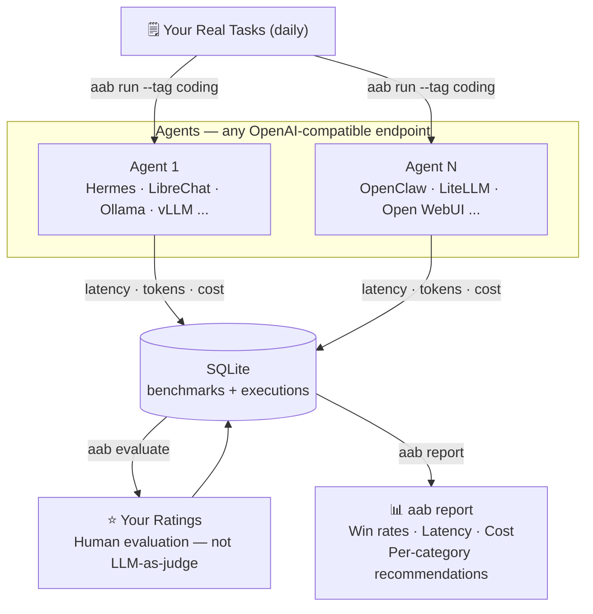
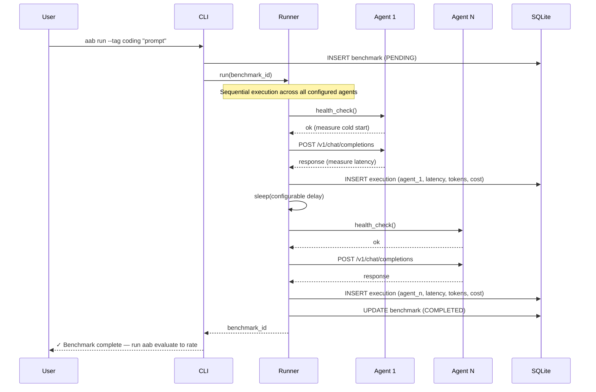
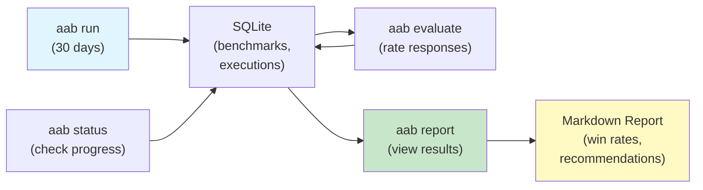

# AgentAssistBench

[](https://github.com/theprodsde/agent-assist-bench/actions/workflows/test.yml)
[](https://github.com/theprodsde/agent-assist-bench/actions/workflows/lint.yml)
[](https://codecov.io/gh/theprodsde/agent-assist-bench)
[](https://www.python.org/downloads/)
[](LICENSE)

A personal evaluation harness for choosing your AI agent stack. Run your actual daily tasks against any number of OpenAI-compatible agents, rate the responses yourself, and get data-driven recommendations after 30 days — not synthetic benchmarks, not LLM-as-judge.

**[Repository](https://github.com/theprodsde/agent-assist-bench) · [Documentation](docs/) · [Issues](https://github.com/theprodsde/agent-assist-bench/issues)**

---

## Who Is This For?

AgentAssistBench is built for engineers and developers who:

- Are **evaluating self-hosted AI agent stacks** — Ollama, LibreChat, Open WebUI, Hermes, OpenClaw, vLLM, LiteLLM — and need to pick one for real work
- Are **tired of synthetic benchmarks** that score a model on tasks they'll never do
- Want to know whether agent A or agent B is better **specifically for coding**, **specifically for research**, or **specifically for devops** — not in aggregate
- Self-host their AI and care about **actual latency and infrastructure cost**, not just quality
- Want their **own judgment** to decide what's "better" — not an automated scorer with its own biases

If you're running two agent stacks and wondering which one to commit to, this tool gives you the answer in 30 days with your own data.

---

## The Problem

You're choosing an AI agent framework for daily work — but every published benchmark scores the *model*, not the stack.

> **The key insight:** Two agent frameworks running the *exact same underlying LLM* can produce wildly different outputs, at wildly different latencies, for wildly different costs.
>
> The framework's system prompt, tool routing logic, memory architecture, context management, and retry behavior all contribute. When you choose LibreChat over Open WebUI, you're not choosing a model — you're choosing all of that. No existing benchmark measures it.

- Synthetic benchmarks (GAIA, SWE-bench, WebArena) test models on curated tasks — not your actual work
- LLM-as-judge introduces its own model's biases and doesn't reflect what *you* value
- "Just try both" gives you a subjective impression, not reproducible data
- You need weeks of your own tasks to separate signal from noise

## The Solution

AgentAssistBench is a self-hosted CLI that runs your actual daily tasks against any number of OpenAI-compatible agents side-by-side, then lets you rate the responses yourself. After 30 days you get per-category win rates, latency comparisons, and cost-per-request — a data-driven answer to "which agent stack should *I* use for *my* work?"

See [docs/sample-report.md](docs/sample-report.md) for a realistic example of what `aab report` produces.

---

## Why Not Just Use X?

| Tool | What it does | Why it doesn't answer your question |
|------|-------------|-------------------------------------|
| GAIA / SWE-bench / WebArena | Leaderboard benchmarks on curated task sets | Scores the model, not the framework; uses tasks you'll never do |
| LMSYS Chatbot Arena | Crowd-sourced human preference between models | Model-vs-model, not framework-vs-framework; no cost/latency; not your tasks |
| promptfoo | Compare prompts and providers with automated evals | Not longitudinal; not framework-stack level; weak on infra cost |
| Langfuse / LangSmith | Observability and evals for an app *you're building* | For apps you ship, not agent stacks you're choosing between |
| "Just try both for a week" | Informal personal testing | Recency bias, no per-category breakdown, no cost data, not reproducible |

AgentAssistBench is the gap: **framework-level, your real tasks, human judgment, 30-day longitudinal, with latency and cost in the same report.**



---

## Quick Start (5 minutes)

### 1. Install

```bash
git clone https://github.com/theprodsde/agent-assist-bench.git
cd agent-assist-bench
```

**With [uv](https://docs.astral.sh/uv/getting-started/installation/) (recommended):**
```bash
uv sync
```
Then prefix commands with `uv run` — e.g. `uv run aab status`.

**With pip (standard):**
```bash
pip install -e .
```
Then run `aab` directly — e.g. `aab status`.

### 2. Configure

```bash
cp .env.example .env
```

**Option A — generic agents (any OpenAI-compatible endpoint)**

Use `BENCH_AGENTS_JSON` to register any number of agents without touching code. Each item needs `name`, `endpoint`, and `model`:

```env
BENCH_AGENTS_JSON=[{"name":"ollama-llama3","endpoint":"http://localhost:11434/v1","model":"llama3"},{"name":"librechat","endpoint":"http://localhost:9000/v1","model":"gpt-4o","api_key":"sk-..."}]
```

**Option B — built-in Hermes / OpenClaw (Docker setup)**

```env
BENCH_HERMES_ENDPOINT=http://localhost:8001/v1
BENCH_OPENCLAW_ENDPOINT=http://localhost:8002/v1
BENCH_HERMES_API_KEY=your-hermes-api-key
BENCH_OPENCLAW_API_KEY=your-openclaw-api-key
```

Both options can be used together — `BENCH_AGENTS_JSON` agents are registered in addition to Hermes/OpenClaw.

See `.env.example` for all available settings with descriptions.

### 3. Run Agents (Docker)

```bash
docker compose -f docker/docker-compose.yml -f docker/docker-compose.override.yml up -d
```

### 4. Send Prompts — pick your interface

Both options hit the same agents and store results in the same database.

---

#### Option A — CLI (terminal)

```bash
# Submit a prompt — runs against all configured agents
aab run "Write a binary search in Python"           # pip install
uv run aab run "Write a binary search in Python"    # uv sync

# With category tags for reporting
aab run --tag coding "Write a binary search in Python"
aab run --tag research --tag devops "Explain Kubernetes vs Docker Swarm"

# Check what ran
aab status

# Rate the responses (interactive)
aab evaluate

# Generate a comparison report
aab report
```

See [CLI.md](CLI.md) for all commands.

---

#### Option B — Telegram bot (send from your phone)

```env
# Add to .env
BENCH_TELEGRAM_BOT_TOKEN=your-token-from-botfather
BENCH_TELEGRAM_ALLOWED_CHAT_IDS=your-numeric-chat-id
```

```bash
uv run aab telegram
```

Send any message to your bot — it benchmarks the prompt across both agents and replies with both responses. Prefix `#tag` to categorise:

```
#coding Write a binary search in Python
```

See [Telegram Bot](#telegram-bot) section for full setup.

---

## Key Features

✅ **Any OpenAI-compatible agent** — Point at Ollama, LibreChat, Open WebUI, vLLM, LiteLLM, Hermes, OpenClaw, or anything behind `/v1/chat/completions` using `BENCH_AGENTS_JSON`

✅ **Your judgment, not LLM-as-judge** — You rate responses 1–5 on your own criteria; no automated scoring introduces its own bias

✅ **Per-category recommendations** — Tag prompts (`--tag coding`, `--tag research`) to get category-specific win rates

✅ **Complete stack comparison** — Measures latency, tokens, cost, and quality in a single report; see [sample output](docs/sample-report.md)

✅ **Multiple deployments** — Test agents on local Docker, VMs, or managed containers with optional cost/resource tracking

✅ **Telegram bot** — Send prompts from your phone, get all agent responses back side-by-side

✅ **Self-hosted, MIT license** — Your data stays local in SQLite; no vendor lock-in

---

## How It Works

### Benchmark Flow



### Evaluation & Reporting



---

## Telegram Bot

Send prompts from your phone and get both agent responses back in the same chat.

### Setup

**1. Create a bot via [@BotFather](https://t.me/BotFather)**

```
/newbot
```

Follow the prompts. Copy the token it gives you.

**2. Find your Telegram chat ID**

Message [@userinfobot](https://t.me/userinfobot) — it replies with your numeric ID (e.g. `123456789`).

**3. Add to `.env`**

```env
BENCH_TELEGRAM_BOT_TOKEN=123456789:ABCdefGHIjklMNO...
BENCH_TELEGRAM_ALLOWED_CHAT_IDS=123456789
```

`BENCH_TELEGRAM_ALLOWED_CHAT_IDS` restricts the bot to your chat only. Anyone else who messages the bot is silently ignored. Leave it empty only if you intentionally want a public bot.

**4. Start the bot**

```bash
aab telegram        # pip install
uv run aab telegram # uv sync
```

```
Telegram bot polling started — send messages to your bot.
Access restricted to chat IDs: 123456789
Press Ctrl-C to stop.
```

### Usage

Send any message to your bot in Telegram:

```
Write a binary search in Python
```

Prefix `#tag` to categorise the benchmark for reporting:

```
#coding Write a binary search in Python
#research #devops Explain Kubernetes vs Docker Swarm
```

The bot runs the prompt through all configured agents sequentially and replies with all responses side-by-side.

---

## Documentation

| Document | Purpose |
|----------|---------|
| [CLI.md](CLI.md) | Command reference (`aab run`, `aab evaluate`, `aab report`, `aab telegram`) |
| [DEPLOYMENT.md](DEPLOYMENT.md) | How to deploy agents locally, on VMs, or in cloud (ACA, Cloud Run) |
| [ARCHITECTURE.md](ARCHITECTURE.md) | System design and component interactions |
| [docs/sample-report.md](docs/sample-report.md) | Realistic example of a 30-day `aab report` output |
| [docs/](docs/) | 16 technical docs: project overview, ADRs, RFCs, roadmap |

---

## Status

**Version: 0.1.0 (MVP)**

| Component | Status |
|-----------|--------|
| CLI (`aab run`, `evaluate`, `report`, `status`) | ✅ |
| Benchmark runner (sequential execution) | ✅ |
| Agent adapters (Hermes, OpenClaw, OpenAI-compatible) | ✅ |
| Generic agent config (`BENCH_AGENTS_JSON` — any N endpoints) | ✅ |
| SQLite storage (CRUD + WAL mode) | ✅ |
| Report generator (per-category win rates) | ✅ |
| Evaluation service (rating + validation) | ✅ |
| Telegram bot (long-polling, access control) | ✅ |
| Tests (unit, integration, property-based) | ✅ |
| CI (lint, type check, parallel tests) | ✅ |
| Docker setup (local agents) | ✅ |
| REST API | 🔜 v0.2 |
| Terraform (VM + ACA deployment) | 🔜 v0.3 |
| Dashboard UI | 🔜 v1.0 |

See [docs/16-roadmap.md](docs/16-roadmap.md) for the full roadmap.

---

## Development

### Prerequisites

- Python 3.11+
- [uv](https://docs.astral.sh/uv/getting-started/installation/)
- Docker (optional, for local agent testing)

### Setup

```bash
uv sync --group dev
```

### Run Tests

```bash
uv run pytest tests/ -v -n auto
```

### Lint & Format

```bash
uv run ruff check benchmark/ tests/
uv run ruff format benchmark/ tests/
```

### Type Check

```bash
uv run mypy benchmark/
```

### Verify Config Loads

```bash
uv run python3 -c "from benchmark.config.settings import Settings; s = Settings(); print(s.hermes_endpoint)"
# or with pip install:
python3 -c "from benchmark.config.settings import Settings; s = Settings(); print(s.hermes_endpoint)"
```

---

## License

MIT — See [LICENSE](LICENSE)

---

## Maintainer

**[TheProdSDE](https://github.com/TheProdSDE)**

Open-source project published under [github.com/theprodsde/agent-assist-bench](https://github.com/theprodsde/agent-assist-bench)

---

## Next Steps

1. **Try it locally** — [Quick Start](#quick-start-5-minutes) above
2. **Set up the Telegram bot** — [Telegram Bot](#telegram-bot) above
3. **Run 30 days of benchmarks** — Tag your real tasks with categories
4. **Rate responses** — `aab evaluate` after accumulating results
5. **Get recommendations** — `aab report` shows per-category win rates
6. **Deploy at scale** — [DEPLOYMENT.md](DEPLOYMENT.md) for VMs or cloud

---

## Feedback

- Found a bug? [Open an issue](https://github.com/theprodsde/agent-assist-bench/issues)
- Want to contribute? See [CONTRIBUTING.md](CONTRIBUTING.md)
- Questions? Discuss in [Discussions](https://github.com/theprodsde/agent-assist-bench/discussions)
